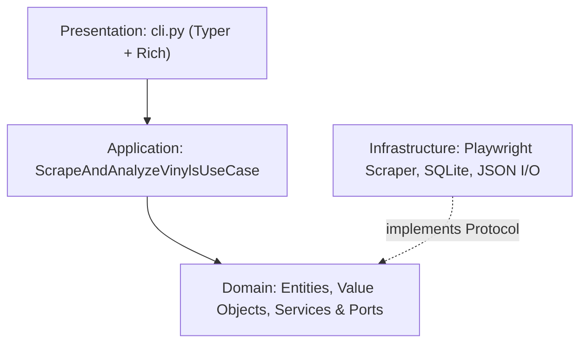

# Arquitetura Técnica — Amazon BR Vinyl Scraper

O projeto segue rigorosamente **Domain-Driven Design (DDD)**, **Clean Architecture (Ports & Adapters)**, **SOLID** e **TDD**.

## Diagrama de Dependências

## Camadas e Responsabilidades

1. **Domain (`src/vinyl_scraper/domain/`)**:
   - **Pureza**: zero dependências externas; apenas stdlib.
   - **Value Objects**: `Money` (BRL com `Decimal`), `ASIN`, `BlackFridayWindow`, `EditionInfo`, `PriceSnapshot`, `PriceStats`, `BlackFridayComparison`, `CostBenefitScore`.
   - **Entities**: `VinylQuery`, `ScrapedEdition`, `VinylEdition`, `AlbumSearchReport`.
   - **Services**: `EditionClassifier` (filtragem de não-vinis e normalização de versões) e `PriceAnalyticsService` (média, mediana, Pré-BF vs BF, falso desconto e custo-benefício).
   - **Ports**: `AmazonScraperPort`, `PriceHistoryRepositoryPort`, `ExternalPriceHistoryPort`, `CatalogReaderPort`, `ReportExporterPort`.
2. **Application (`src/vinyl_scraper/application/`)**:
   - `ScrapeAndAnalyzeVinylsUseCase`: orquestra leitura JSON, scraping/análise offline, deduplicação por ASIN, persistência local e fusão com histórico externo.
3. **Infrastructure (`src/vinyl_scraper/infrastructure/`)**:
   - `AmazonBrSearchParser` + `PlaywrightAmazonScraper`: coleta paginada na Amazon BR e detecção limpa de CAPTCHA (`ScraperBlockedError`).
   - `SqlitePriceHistoryRepository`: persistência temporal em SQLite.
   - `NullExternalPriceHistory`: adaptador padrão pronto para extensão (ex.: Keepa API).
   - `JsonCatalogReader` e `JsonReportExporter`: entrada e saída JSON.
4. **Presentation (`src/vinyl_scraper/presentation/`)**:
   - `cli.py`: comandos `run` e `analyze` com tabelas Rich.
